# Relay

On-demand mobile app connecting Fulham (SW6) customers with vetted plumbers, electricians and Gas Safe heating engineers. Customers book an urgent callout or a fixed-price job; tradespeople accept nearby jobs they are qualified for.

Plan: [MVP plan](https://claude.ai/artifact/F4z5StZkvHjedKoJgYnkAK) · [Phase 0 launch kit](https://claude.ai/artifact/W9jngfqw8W2ubkRBQcGEyp)

## What's here

| Path | What it is |
| --- | --- |
| `mobile/` | One Expo (React Native) codebase that builds two store apps: **Relay** for customers and **Relay Traders** for tradespeople |
| `mobile/src/domain/` | Launch catalogue (trades, job types, prices, required credentials) and pure business rules, with tests |
| `supabase/migrations/` | Postgres schema: profiles, pros, credentials, jobs, offers, row level security, matching functions |
| `supabase/tests/` | SQL behaviour tests for vetting, matching and accepting offers |

## Run the apps

Needs Node 22 and the Expo Go app (or a simulator).

```bash
cd mobile
npm install
npm start          # customer app (Relay)
npm run start:pro  # tradesperson app (Relay Traders)
```

Scan the QR code with Expo Go. When switching between the two apps, add `-- --clear` so the bundler does not reuse the other app's config.

Without Supabase settings the apps run in **demo mode** with sample jobs. To connect a backend, copy `mobile/.env.example` to `mobile/.env.local` and fill in your Supabase URL and anon key.

## Set up the backend

1. Create a project at [supabase.com](https://supabase.com) (London region).
2. From the repo root: `npx supabase init`, `npx supabase link --project-ref <ref>`, then `npx supabase db push`.

`nearest_eligible_pros` is not callable by app users; it is meant for a server-side dispatcher (an Edge Function using the service role), which is the next piece of work.

## Checks

```bash
cd mobile && npm run typecheck && npx eslint . && npm test
supabase/tests/run.sh   # needs psql and Postgres with PostGIS (PG* env vars)
```

CI runs both on every pull request.

## Screenshots (demo mode)

The look comes from the v0 design boards for Relay and Relay Traders. In demo mode (no Supabase keys) each flow plays through on a timer, so you can tap from request to payment on a phone.

| Relay: home | Choose the job | Pro on the way | Job done and pay |
| --- | --- | --- | --- |
| 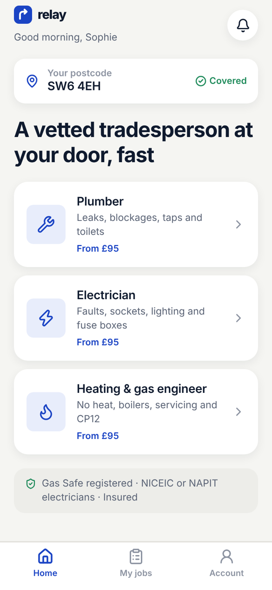 | 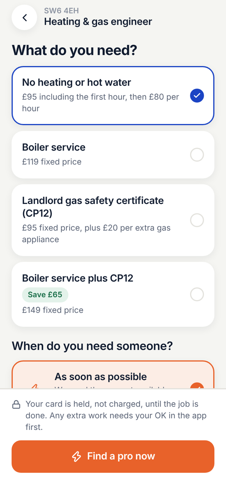 | 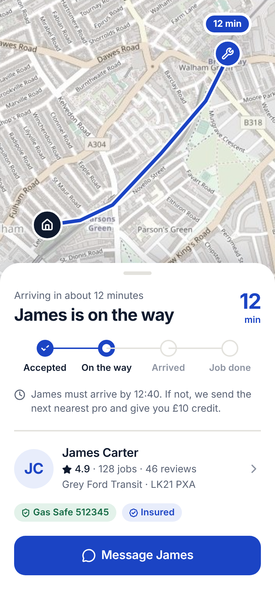 |  |

| Relay Traders: go online | 60-second job offer | On the job | Earnings |
| --- | --- | --- | --- |
| 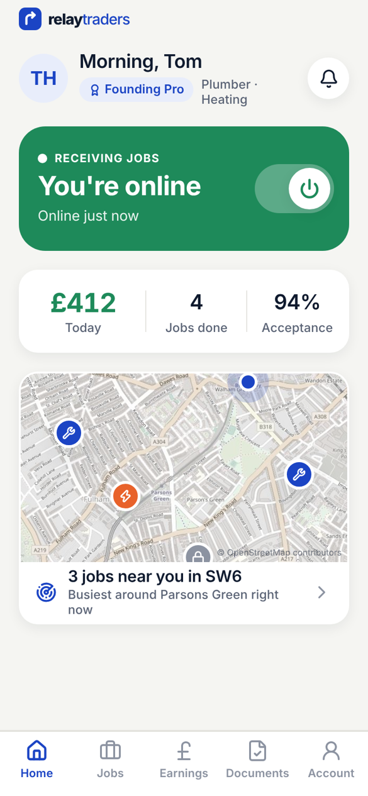 | 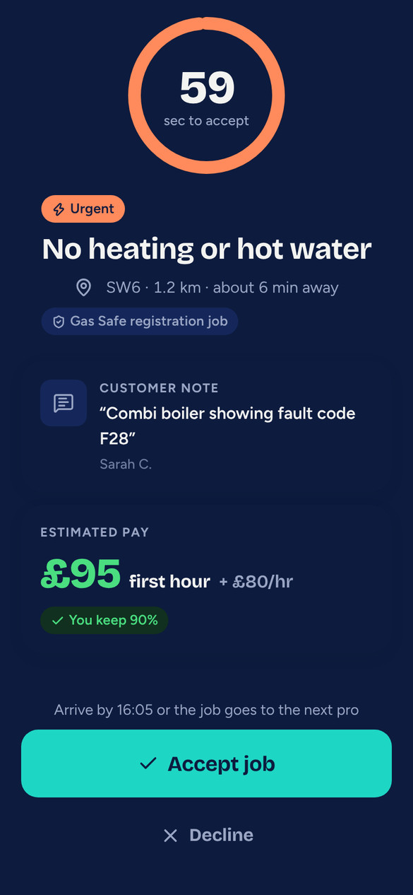 | 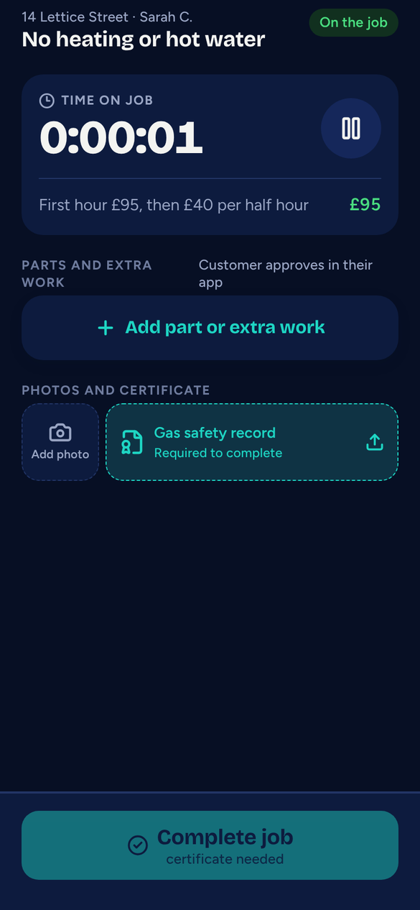 | 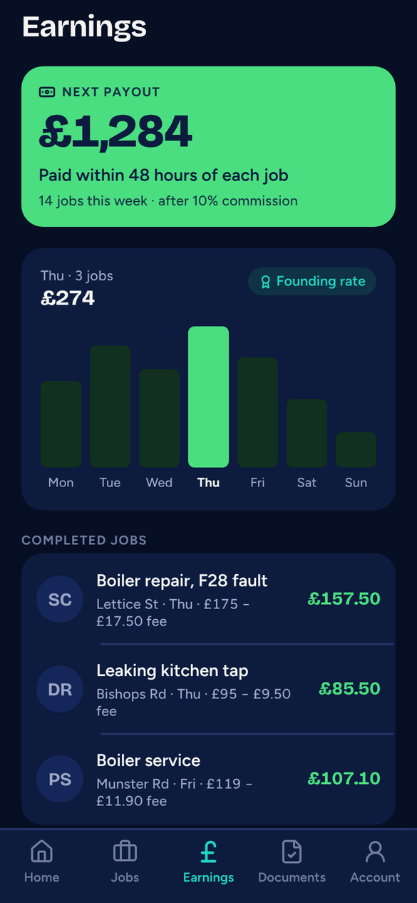 |

Pilot trust features: confirm or report, Relay Guarantee, in-app chat with numbers hidden, verified reviews, and no-show reassignment.

| Confirm or report | Report a problem | Chat, numbers hidden | Pro profile and reviews |
| --- | --- | --- | --- |
| 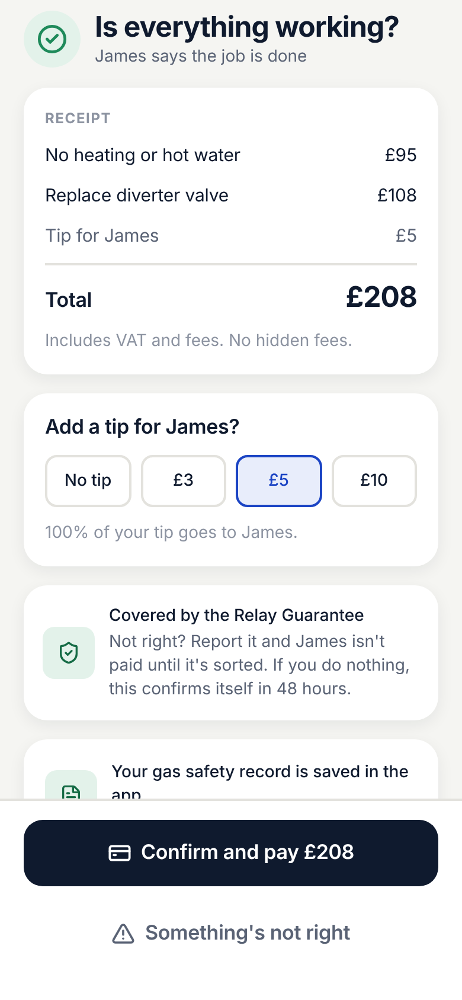 | 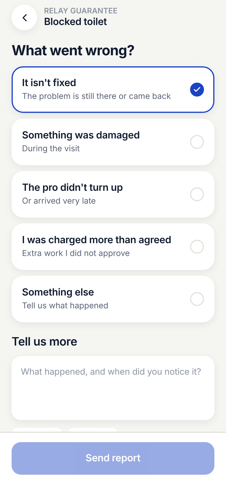 | 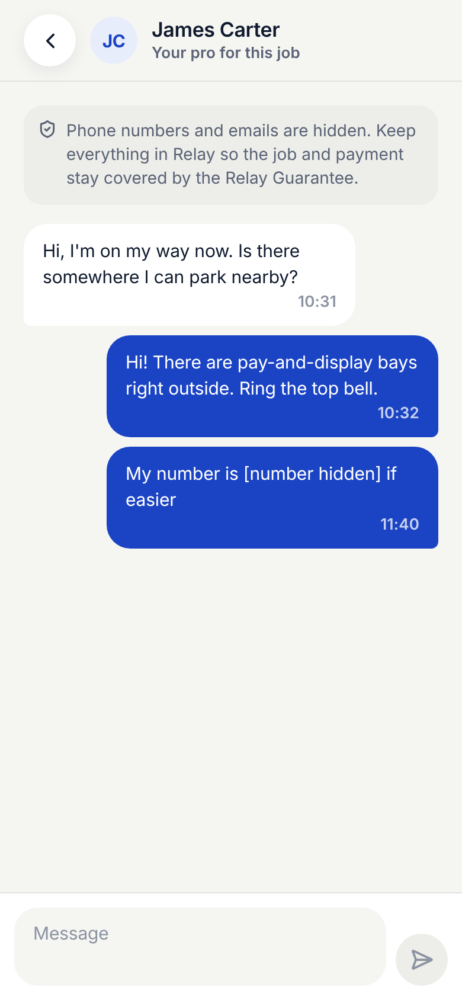 | 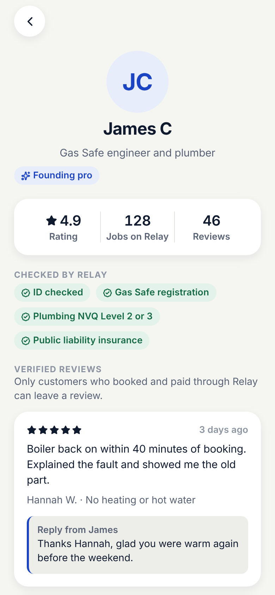 |

| Late pro, job reassigned | Traders: arrive-by deadline | Waiting for the customer | Reply to reviews |
| --- | --- | --- | --- |
| 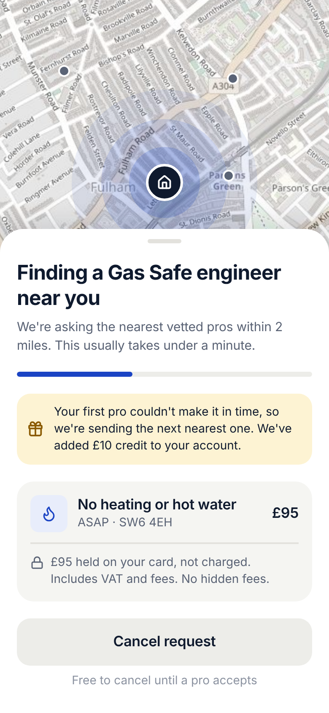 | 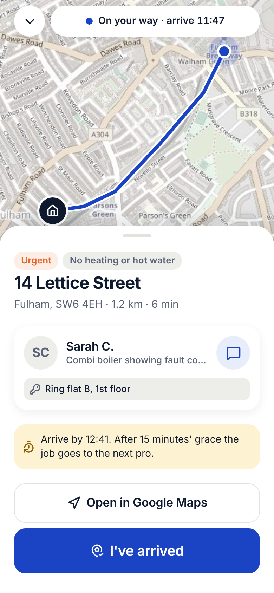 | 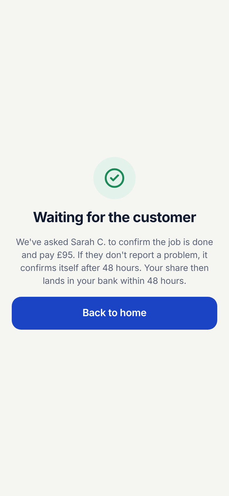 | 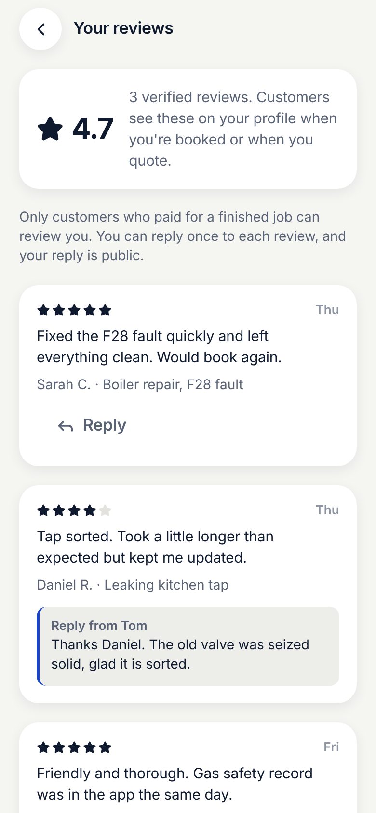 |

The Fulham map is a static OpenStreetMap image (© OpenStreetMap contributors) until live maps are added.
